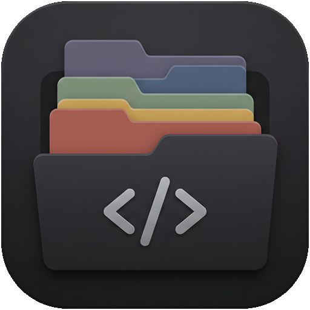
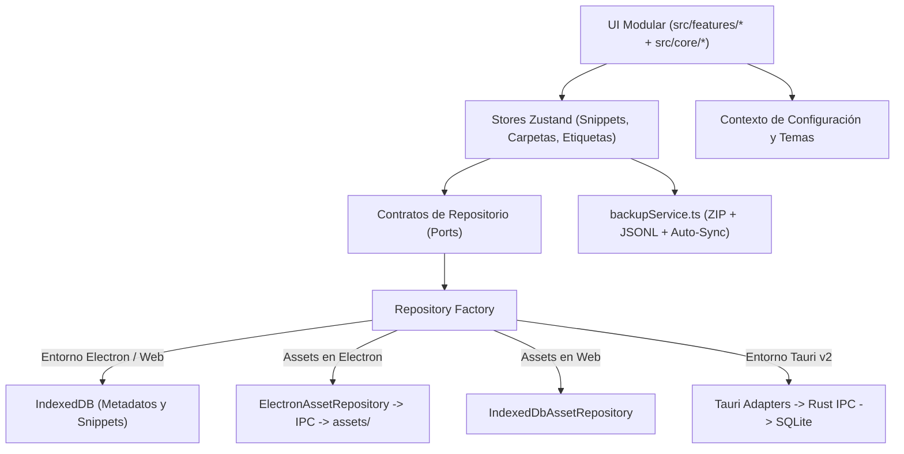

# CodeStash

<div align="center">
  
  <p><strong>Gestor de escritorio offline para fragmentos de código, notas técnicas y documentación Markdown</strong></p>
  <p>
    <a href="LICENSE"></a>
    
    
    
    
    
    
  </p>
</div>

---

## Descripción

**CodeStash** es una aplicación de escritorio **100% offline** diseñada para desarrolladores que necesitan centralizar fragmentos de código, comandos, notas técnicas enriquecidas con imágenes y documentación en Markdown sin depender de servicios en la nube ni telemetría.

Está construida siguiendo una arquitectura modular (**Feature-Sliced Design** + **Ports & Adapters**), con interfaz minimalista adaptable por temas e internacionalización en **Español** e **Inglés**.

---

## Características principales

### Organización y productividad
- **Privacidad total y funcionamiento *Offline-First***: tus datos, notas e imágenes permanecen almacenados localmente en tu equipo sin conexiones externas ni cuentas de usuario.
- **Arquitectura multi-fragmento**: cada snippet soporta múltiples pestañas internas reordenables y renombrables para agrupar variantes, archivos o pasos relacionados.
- **Carpetas jerárquicas y etiquetas**: organiza snippets en carpetas anidadas (con drag & drop y selección múltiple), etiquetas con color/icono, vista de **Favoritos** y **Papelera** con restauración o eliminación definitiva.
- **Búsqueda en tiempo real**: filtrado instantáneo sobre títulos, etiquetas, descripciones y contenido.
- **Atajos de teclado**: creación rápida de snippets (`Ctrl/Cmd + N`), carpetas (`Ctrl/Cmd + Shift + N`), acceso a configuración (`Ctrl/Cmd + ,`), duplicación y selección múltiple.

### Editor dual, Markdown y diagramas
- **Modo Código ([CodeMirror 6](https://codemirror.net/))**: resaltado de sintaxis, numeración de líneas, ajuste de línea e indentación configurable para **14 modos de lenguaje**:
  `TypeScript`, `JavaScript`, `Rust`, `Python`, `Java`, `C++`, `SQL`, `HTML`, `CSS`, `JSON`, `Markdown`, `Shell / Bash`, `YAML` y `Plain Text`.
- **Detección inteligente de lenguaje**: al pegar contenido desde el portapapeles, el motor ponderado detecta automáticamente el lenguaje correspondiente (con reglas específicas para evitar que bloques de código incrustados en Markdown secuestren la detección).
- **Previsualización Markdown avanzada**:
  - Alternancia directa entre código fuente y previsualización renderizada.
  - Soporte para **GitHub Flavored Markdown (GFM)**, tablas, listas de tareas, bloques de alerta (`NOTE`, `TIP`, `IMPORTANT`, `WARNING`, `CAUTION`), fórmulas matemáticas (**KaTeX**) y resaltado de bloques de código con copia rápida.
  - Renderizado interactivo de **diagramas Mermaid** (Flowchart, Sequence, Class, State, ER, Gantt, Pie, Git Graph, Mindmap, C4, Architecture, Kanban, XY Chart, entre otros) y **bloques SVG sanitizados**.
- **Modo Texto Enriquecido ([Tiptap](https://tiptap.dev/)) para `Plain Text`**:
  - Formato enriquecido (encabezados, listas con viñetas/guiones/numeradas, checklists interactivos, citas, tablas redimensionables, colores de texto y resaltado).
  - Inserción y pegado de **imágenes redimensionables** almacenadas como activos locales binarios.
- **Corrector ortográfico bilingüe (`es` / `en`)** en texto enriquecido con menú contextual integrado.

### Respaldos, portabilidad y personalización
- **Sincronización y respaldos portables**:
  - Respaldo automático local (`codestash-backup.jsonl`).
  - Exportación e importación manual en formato **`.zip`** (incluye metadatos, snippets e imágenes/assets binarios) y **`.jsonl`**, con vista previa de conteos antes de confirmar la restauración.
- **Temas integrados y temas JSON personalizados**:
  - Incluye 4 temas de fábrica: **CodeStash - OneDark** *(predeterminado)*, **CodeStash - Spacegray**, **One Dark** y **CodeStash - Light Modern**.
  - Soporte para temas externos y edición local mediante `appearance-config.json`.
- **Distribución dual en Windows**: instalador **NSIS** y binario **Portable** (que guarda su directorio `data/` junto al ejecutable).

---

## Arquitectura general

CodeStash desacopla la interfaz React del almacenamiento subyacente mediante puertos (`src/shared/api/contracts/`) y adaptadores resueltos en tiempo de ejecución por `createRepositories()`:



- **Feature-Sliced Design (`src/features/*`)**: cada dominio (`navigation`, `folders`, `tags`, `snippets`, `settings`) encapsula sus componentes, hooks, estado y pruebas unitarias.
- **Almacenamiento desacoplado y binarios externos**: en Electron los snippets/metadatos viven en IndexedDB y las imágenes adjuntas se guardan como activos binarios en disco (`electron/assetStorage.cjs`) con limpieza automática de archivos huérfanos (`assetGarbageCollector.ts`).
- **Aislamiento y sanitización**: `contextIsolation: true`, `sandbox: true`, bloqueo de navegaciones no locales, `rehype-sanitize` + `DOMPurify` en Markdown/SVG y `securityLevel: "strict"` en Mermaid. Consulta [SECURITY.md](SECURITY.md) para más detalles.

---

## Stack tecnológico

| Capa | Tecnologías |
| :--- | :--- |
| **Interfaz** | React 19, TypeScript 5.7, Tailwind CSS v4, Lucide React |
| **Estado y Utilidades** | Zustand 5, `clsx`, `tailwind-merge`, `class-variance-authority` |
| **Editor de Código** | CodeMirror 6 (`@uiw/react-codemirror`, paquetes `@codemirror/lang-*`) |
| **Editor Enriquecido** | Tiptap v3 (`@tiptap/react`, tablas, listas de tareas, Markdown, imágenes) |
| **Markdown y Diagramas** | `react-markdown`, `remark-gfm`, `remark-math`, `rehype-katex`, `rehype-highlight`, `rehype-sanitize`, Mermaid 12, DOMPurify, KaTeX |
| **Desktop Runtime** | Electron 34 (`electron-builder` NSIS/Portable) y backend alternativo Tauri v2 (`src-tauri/`, Rust + `rusqlite`) |
| **Pruebas** | Vitest 5, Testing Library (`@testing-library/react`, `@testing-library/jest-dom`), `jsdom` |

---

## Requisitos previos e instalación

### Requisitos
- **Node.js** 20 o superior y **npm**.
- **Rust y Cargo** *(opcional: solo si deseas compilar o ejecutar la variante nativa Tauri en `src-tauri/`)*.

### Puesta en marcha

```bash
# 1. Clonar el repositorio
git clone https://github.com/dev-yorsh/code-stash-app.git
cd code-stash-app

# 2. Instalar dependencias
npm install

# 3. Iniciar la aplicación en modo desarrollo (Vite + Electron)
npm run dev:app
```

---

## Scripts disponibles

| Comando | Descripción |
| :--- | :--- |
| `npm run dev:app` | Inicia el servidor de desarrollo Vite junto con Electron con recarga rápida. |
| `npm run dev` | Levanta únicamente el servidor frontend de Vite en el puerto `1420`. |
| `npm run start` | Ejecuta Electron apuntando a la aplicación empaquetada actual. |
| `npm run build` | Valida tipos con `tsc` y genera el bundle de producción en `dist/`. |
| `npm test` | Ejecuta la suite completa de pruebas unitarias e integración con Vitest. |
| `npx tsc --noEmit` | Ejecuta únicamente la verificación estática de TypeScript. |
| `npm run electron:build` | Compila frontend y empaqueta los ejecutables de Windows (`NSIS` y `Portable`) en `release/`. |
| `npm run tauri dev` / `build` | Ejecuta o compila la variante experimental con backend nativo Tauri v2 / Rust. |

---

## Atajos de teclado principales

| Ámbito | Atajo | Acción |
| :--- | :--- | :--- |
| **Global** | `Ctrl/Cmd + N` | Crear nuevo snippet |
| **Global** | `Ctrl/Cmd + Shift + N` | Crear nueva carpeta |
| **Global** | `Ctrl/Cmd + ,` | Abrir Configuración |
| **Carpetas** | `F2` | Renombrar carpeta seleccionada |
| **Lista de snippets** | `Ctrl/Cmd + A` / `D` | Seleccionar todos / duplicar snippet activo |
| **Lista y carpetas** | `Delete` / `Backspace` | Enviar a Papelera / solicitar eliminación |

---

## Estructura del proyecto

```text
code-stash/
├── electron/               # Proceso principal Electron, preload IPC, almacenamiento de assets y corrector ortográfico
├── public/                 # Recursos estáticos públicos (iconos y logotipo)
├── scripts/                # Scripts auxiliares de desarrollo y generación de iconos
├── src/
│   ├── core/               # Utilidades transversales, barra de título, tokens base y detector de lenguaje
│   ├── features/           # Módulos funcionales (navigation, folders, tags, snippets, editor, settings)
│   ├── services/           # Servicios de configuración local (appearance-config.json) y respaldos (ZIP/JSONL)
│   └── shared/             # Contratos Ports & Adapters, repositorios (IDB/Tauri/Fallback), UI base e i18n
├── src-tauri/              # Backend nativo en Rust (Tauri v2 + SQLite) detrás de los mismos contratos
├── package.json            # Dependencias, scripts y configuración de electron-builder
├── vite.config.ts          # Configuración del bundler Vite
└── vitest.config.ts        # Configuración de entorno jsdom y pruebas Vitest
```

---

## Documentación adicional

- [Guía de Contribución](CONTRIBUTING.md) — Estándares de código, flujo de PRs y verificaciones antes de contribuir.
- [Política de Seguridad y Privacidad](SECURITY.md) — Controles de aislamiento, sanitización y reporte responsable.
- [Registro de Cambios](CHANGELOG.md) — Historial de la versión actual.

---

## Créditos

Referencias visuales que inspiraron el diseño y contraste de los temas incluidos:

- **One Dark**: [atom/one-dark-ui](https://github.com/atom/atom/tree/master/packages/one-dark-ui) y `@codemirror/theme-one-dark`.
- **Ayu Palette**: [ayu-theme/ayu-colors](https://github.com/ayu-theme/ayu-colors).

---

## Autor y licencia

- **Autor**: Jorge Pingo Requena ([GitHub](https://github.com/dev-yorsh/code-stash-app) · [LinkedIn](https://www.linkedin.com/in/jorge-pr))
- **Licencia**: Distribuido bajo la licencia **Apache License 2.0**. Consulta [LICENSE](LICENSE) y [NOTICE](NOTICE) para más detalles.
